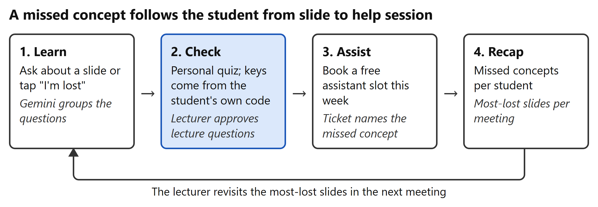
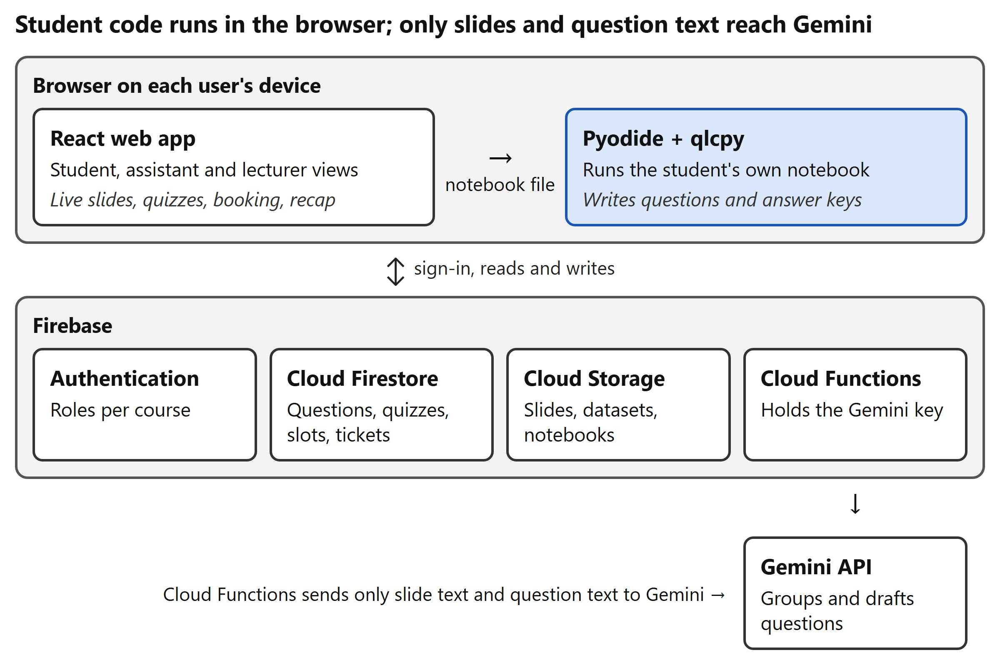
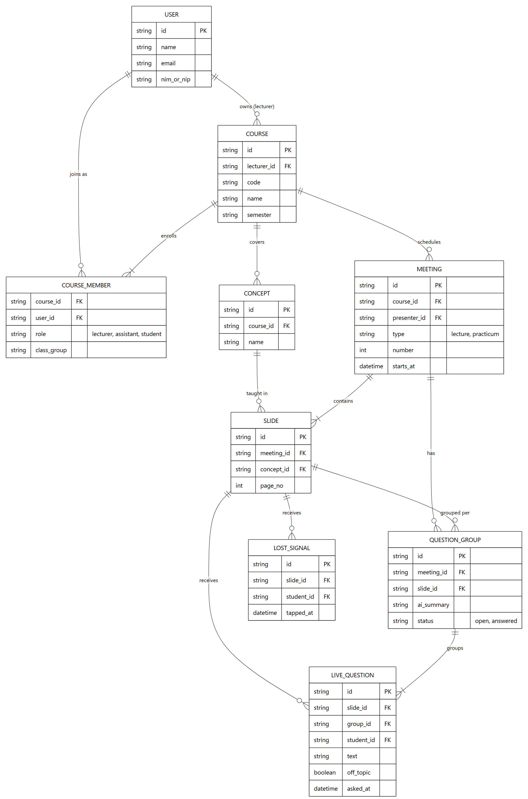
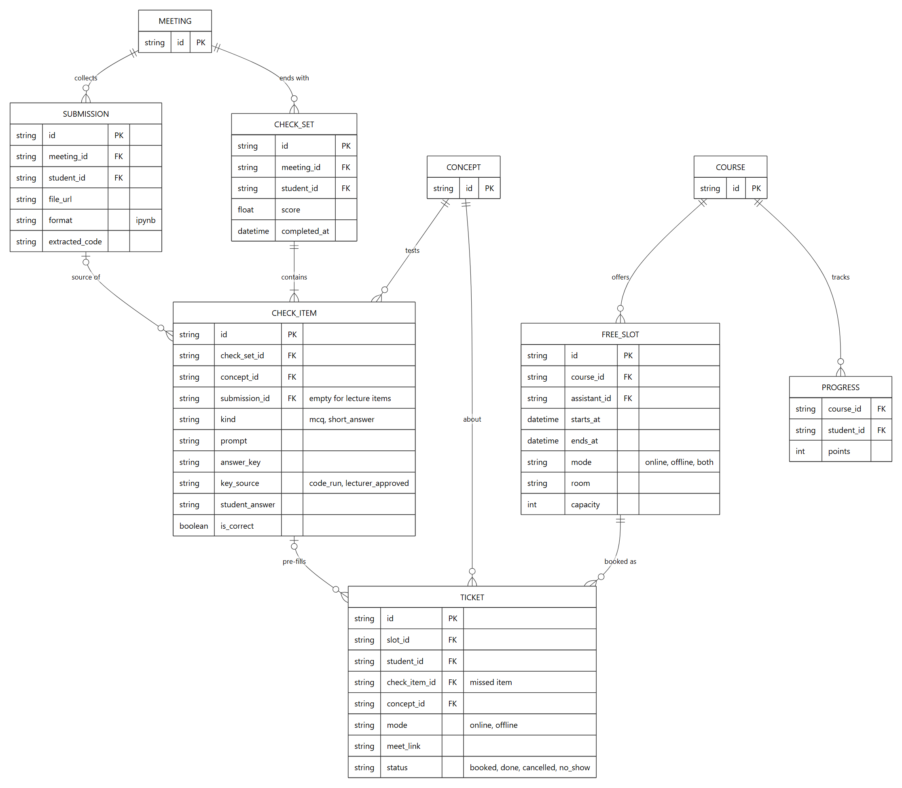

# SAPA: From Lecture Questions to Own-Code Quizzes and Practicum Help

Semifinal Proposal, STACK 2026

Team: wo men bu yi yang

Case 1: Smarter Campus and Learning

Muhammad Ridwan (team leader), Nur Fattah Hamdani, Annisa Sofia Albana, Naufal Fahreza

Telkom University Surabaya

<!-- pagebreak -->

## 1. Project and Team Identity

SAPA is a web application for one university course, built by team wo men bu yi yang from Telkom University Surabaya for Case 1: Smarter Campus and Learning.

**Summary.** In lectures, students ask about a slide anonymously or tap "I'm lost". After each meeting, each student gets a short quiz built from the slides they marked and from their own practicum notebook, with answer keys computed by running that code in the browser. A missed question leads to a help session with an assistant who already sees the missed concept. Version one targets one practicum class in a data science course where two of us are assistants.

| Member | Role in the team | Main build area |
| --- | --- | --- |
| Muhammad Ridwan | Team leader, AI, practicum assistant | Gemini question grouping and lecture question drafts, qlcpy question templates |
| Nur Fattah Hamdani | Web (front end), practicum assistant | React screens, notebook upload and the Pyodide runner |
| Naufal Fahreza | Web (back end) | Firebase sign-in and roles, Firestore data and rules, Cloud Functions, deployment |
| Annisa Sofia Albana | Design | User flows and screen designs for students, assistants and the lecturer |

Muhammad Ridwan and Nur Fattah Hamdani are practicum assistants in the course SAPA is designed for. They assist two different classes of the same student cohort.

## 2. Problem and User Analysis

In our data science course, the assistants review each submitted notebook and its outputs, but no one checks whether the student can explain the code, and students who get lost in a lecture rarely say so. What a student has not understood stays hidden until grades show it.

### 2.1 Problem context

The course has weekly lectures and 13 weekly Python practicum modules. The problem has two causes and one consequence.

1. **Students submit code they cannot explain.** A submitted notebook shows that the code exists and runs. It does not show whether the student understands it, and 8 of our 10 survey respondents write their code with help from AI tools.
2. **Students who get lost in a lecture stay quiet.** They find it hard to phrase a question or do not want to interrupt, so the lecturer does not learn which slide lost the class.
3. **As a result, assistants start each help request without context.** One assistant helps many students one by one and first has to work out what each student is stuck on.

### 2.2 Target users

| User | What they need | What they do today |
| --- | --- | --- |
| Student | Find out what they do not understand before the exam, and ask without being exposed | Copy or adapt working code, ask a friend, or stay quiet |
| Practicum assistant | Know what a student is stuck on before the help session starts | Read the student's code on the spot to find what they are stuck on |
| Lecturer | See which slides and concepts lost the class | Rely on the few students who speak up and on exam results |

### 2.3 Supporting evidence

**Published studies.** Large classrooms make some students apprehensive about asking questions [1]. A lab teaching assistant's firsthand account describes working out each student's problem without prior context while other students wait [2]. In an online introductory programming course, about one third of students struggled to explain their own code, and explaining it tracked course success better than submitting a correct program [3].

**Our own course.** Earlier cohorts of this course pasted their code as screenshots into PDF reports, which cannot be run. The current cohort submits the official weekly post-test as a Colab notebook (.ipynb), so each student's code can now be run, and uploading it to SAPA adds no new file to prepare. Students submit the notebook with its cell outputs already saved. The assistants review the code, its structure and the outputs against the task, but have no time to ask each student to explain the code.

**Survey of our two practicum classes, 23 to 26 November 2026.** 10 of 66 students (15%) answered an anonymous online survey. The sample is small and self-selected, so we treat it as a first signal, not a measure of the whole cohort. Full results are in Appendix B.

- All 10 had submitted practicum code they could not explain line by line at least once in the past four weeks, and 6 said this happens almost every week. 8 of 10 write their practicum code with help from AI tools.
- All 10 had been confused in a lecture without asking at least once in the past four weeks. The most common reasons were not knowing how to phrase the question (6) and not wanting to interrupt the class (5). Only 2 named embarrassment. An "I'm lost" tap needs no wording, which fits the most common reason.
- All 10 already submit notebook files, and none objected to uploading them. Six also put screenshots in a report, which an extra task set by the assistants sometimes asks for.
- Of the 7 who had asked an assistant for help, none waited more than 10 minutes. SAPA therefore does not aim to cut waiting time; it gives the assistant the missed concept before the session.
- Two results are weaker. Only 3 of 10 said they would likely take a short quiz about their own code, and 7 were unsure. Five of 10 were neutral about asking more often if classmates could not see their name. We treat quiz uptake as an open risk (Section 5.1).

### 2.4 Existing alternatives

| Alternative | What it does well | What it does not cover |
| --- | --- | --- |
| Slido | Anonymous live questions with upvotes | Does not connect questions to slides a student missed or to a follow-up quiz |
| Kahoot | Engaging quiz for the whole class | Every student gets the same questions, unrelated to their own code |
| nbgrader | Grades notebooks against tests the instructor writes | Checks that code is correct, not that the student can explain it |
| WhatsApp group for asistensi | Students already use it to ask assistants | No booking of free slots, and the assistant sees no context before the session |

## 3. Proposed Solution

SAPA turns what a student misses into a short personal quiz, and a missed quiz question into a help session with an assistant who already knows the concept.

### 3.1 Main user journey

{w=16}

1. **Learn.** During a meeting, students follow the slides on their own device. They can ask about any slide anonymously (Section 6.4), or tap "I'm lost". Gemini groups similar questions per slide and sets aside off-topic ones, so the presenter answers the largest groups first.
2. **Check.** After the meeting, each student gets a short quiz of multiple-choice or short-answer questions.
    - Lecture questions: Gemini drafts them from the slides the student marked "I'm lost", and the lecturer approves them before students see them.
    - Practicum questions: the student uploads their notebook and SAPA runs it in the browser. qlcpy [4] writes questions about the structure of the student's code, and our own templates ask about the values it produces. The answer keys come from running that code (example in Section 4.3).
    - Students see the correct answers after the quiz. Results count only toward participation points.
3. **Assist.** A student who missed a concept books a help session (asistensi) in a free slot that an assistant opened that week, online or offline. The ticket already names the missed concept and the question.
4. **Recap.** The lecturer and assistants see each student's missed concepts and the most-lost slides for each meeting.

### 3.2 Scope of version one

| In version one | Left for later |
| --- | --- |
| One course, one practicum class | Several courses and classes |
| The 9 practicum modules whose libraries run in the browser | The 4 modules that need TensorFlow or PySpark |
| Notebook upload (.ipynb) | Reading code from screenshots or PDF reports |
| Multiple-choice and short-answer questions | Automatic grading of free-text explanations |
| Help-session booking with the missed concept | Video calls inside SAPA (online sessions use a meeting link) |

We checked the imports in the lecturer's 13 practicum notebooks. Nine use only pandas, NumPy, scikit-learn, matplotlib or NetworkX, which Pyodide supports, and they load scikit-learn's built-in datasets instead of downloading files. Version one covers these nine. The other four need TensorFlow (one module) or PySpark (three modules).

### 3.3 Distinguishing features

- **Questions about the student's own code.** Each practicum question is generated from the notebook that student submitted, so the quiz asks about their own variables and results instead of one shared answer sheet.
- **Answer keys from running the code.** The correct answer is whatever the student's code produces, so no one writes keys for each submission.
- **One thread from confusion to help.** An "I'm lost" tap leads to a quiz question, and a missed quiz question leads to a help ticket with that concept already filled in.

## 4. Technical Design

SAPA is a React web app on Firebase. Student notebooks run inside the student's browser with Pyodide, and only the Gemini calls run on the server.

{w=13}

### 4.1 Technologies

| Layer | Technology | Role in SAPA |
| --- | --- | --- |
| Front end | React | Student, assistant and lecturer views |
| Sign-in | Firebase Authentication | Roles per course: lecturer, assistant, student |
| Database | Cloud Firestore | Live slide, questions, quizzes, slots and tickets, updated in real time |
| Files | Cloud Storage for Firebase | Slides, lecturer datasets and student notebooks |
| Server logic | Cloud Functions for Firebase | Calls Gemini and keeps its key on the server |
| AI | Gemini API | Groups questions and drafts lecture questions |
| Code runner | Pyodide (Python in the browser) | Runs pandas and scikit-learn code with no server cost per student |
| Question generator | qlcpy [4] | Generates questions about a learner's own Python program |

Cloud Storage for Firebase requires the pay-as-you-go Blaze plan. We will set a budget alert and expect one class to stay within the no-cost usage limits.

### 4.2 Data sources

The lecturer uploads slides (PDF) and any data file a module uses. Students upload their own notebooks, which are used only to build their own quiz. Each course has a short list of concepts set by the lecturer, such as "filtering rows" or "groupby". The lecturer tags each slide with a concept when uploading it, and the team tags each question template with the concept it tests, so quiz questions, tickets and the recap all use the same list. The semifinal video and Final Day demo use notebooks the team wrote, so no real student work appears in any demo. The data model has 15 entities, including Course, Meeting, Slide, Question Group, Submission, Check Item, Free Slot and Ticket (Appendix A).

### 4.3 Running real notebooks

| Case | How SAPA handles it |
| --- | --- |
| `!pip install` lines | Removed before the run; Pyodide loads the supported packages itself |
| Reading files from Google Drive | `drive.mount` is removed and Drive paths point to the lecturer's copy of the dataset |
| A cell raises an error | Later cells still run; questions that depend on the failed cell are skipped |
| The notebook cannot run at all | The student gets questions from reading the code only, and the assistant is notified |

**Worked example.** We ran qlcpy 1.0.18 in desktop Python on a sample function written for this test, using a scikit-learn built-in dataset (lines 5 to 11 of the file):

```
 5  def class_means(min_length):
 6      iris = load_iris(as_frame=True)
 7      df = iris.frame
 8      long_ones = df[df["sepal length (cm)"] > min_length]
 9      means = long_ones.groupby("target")["petal length (cm)"].mean()
10      best = means.idxmax()
11      return best
```

| Question | Source | Answer key | Concept |
| --- | --- | --- | --- |
| A value is read from `means` on line 10. On which line is `means` created? | qlcpy output | Line 9 | Variables |
| Which of these are variable names in the program: df, long_ones, foo, total, def? | qlcpy output | df, long_ones | Variables |
| How many rows does `long_ones` have when `min_length` is 5.0? | Our template (planned) | 118, from running the code | Filtering rows |
| What does `class_means(5.0)` return? | Our template (planned) | 2, from running the code | Groupby |

The test showed that qlcpy asks about the structure of pandas code but not about the values it produces, so our own templates add the value questions. We have not yet tested qlcpy inside Pyodide; this is the first build task (Section 5.3). If qlcpy does not run there, we write all templates with Python's `ast` module, which Pyodide includes, so student code still stays in the browser.

### 4.4 Answer keys computed in the browser

A student with technical skill could change keys computed in their own browser. We accept this in version one because quiz results count only toward participation points. If a lecturer wants quiz results to count toward grades, the server can re-run the notebook to produce the keys.

## 5. Development Plan

Building started on 27 November 2026. We will arrive at Final Day with the Learn and Check steps working, and use the build session to connect missed quiz questions to help-session booking and the recap.

### 5.1 Current progress

| Feature | Status on 29 November |
| --- | --- |
| Live slides with questions, names hidden | Not started |
| "I'm lost" tap | Not started |
| Question grouping with Gemini | Prompt tested on 50 sample questions (Section 6.1); not in the app yet |
| Notebook upload and run with Pyodide | Not started |
| Practicum quiz from qlcpy and our templates | Not started; qlcpy tested in desktop Python only (Section 4.3) |
| Lecture quiz with lecturer approval | Not started |
| Help-session booking | Not started; planned for Final Day |
| Recap for lecturer and assistants | Not started; planned for Final Day |

**Still a hypothesis.** These points are not tested yet. The usability test and pilot in Section 6 are designed to check them.

- qlcpy runs inside Pyodide. If it does not, we write all question templates with Python's `ast` module, which also runs in the browser (Section 4.3).
- Students take a voluntary weekly quiz that counts only toward participation points. In the survey, 3 of 10 said they were likely to and 7 were unsure, so the usability test checks whether a short quiz with answers shown right away is worth their time.
- Quiz scores agree with whether a student can explain their code to an assistant.
- Gemini groups real students' informal Indonesian questions as well as it grouped our sample set.

### 5.2 Milestones

| Dates | Milestone | Done when |
| --- | --- | --- |
| 21 to 29 Nov 2026 | Proposal, survey, semifinal video | Proposal PDF and Instagram video are submitted |
| 27 to 28 Nov 2026 | Prototype work starts | Project set up; qlcpy tested inside Pyodide; first mockups for the video |
| 30 Nov to 6 Dec 2026 | Learn step end to end | Team members in a test class can ask, tap "I'm lost" and see grouped questions |
| 30 Nov to 6 Dec 2026 | Check step end to end | A sample notebook produces a quiz with keys from its own run |
| 7 to 15 Dec 2026 | Usability test and fixes | Five students outside the team complete the main flow with sample data |
| 19 Dec 2026 | Final Day build session | Booking and recap connected to the quiz results |
| Next semester (2027) | Pilot in one practicum class | Class and dates agreed with the lecturer |

### 5.3 Member contributions

| Member | Done so far | Before Final Day | On Final Day |
| --- | --- | --- | --- |
| Muhammad Ridwan | Survey, proposal | Gemini grouping and lecture question drafts, qlcpy question templates, survey, video | Missed concept on the help ticket, pitch |
| Nur Fattah Hamdani | Not started | Notebook upload, Pyodide runner, quiz screens | Recap screen |
| Naufal Fahreza | Not started | Sign-in roles, Firestore rules, Cloud Functions, deployment | Booking flow and free slots |
| Annisa Sofia Albana | Not started | Screen designs, mockups for the video, usability test sessions | Booking and recap screen designs, demo flow |

**Skills and gaps.** Ridwan and Dani assist this practicum every week, so they know the modules and where students get stuck. Our main gap is experience running real notebooks in the browser for a whole class, so Dani tests Pyodide on the lecturer's nine notebooks before we build on top of it. Before real students use question grouping, Ridwan checked it on 50 sample questions the team wrote (Section 6.1).

### 5.4 Planned Final Day tasks

1. **Help-session booking.** Assistants open free slots for the week, and a student books one from a missed quiz question.
2. **Missed concept on the ticket.** The ticket shows the concept and the question the student missed, so the assistant sees it before the session.
3. **Recap.** The lecturer and assistants see missed concepts per student and the most-lost slides per meeting.

We keep a local demo build and sample data in case the venue network fails.

## 6. Validation and Impact

We will judge SAPA by two numbers: how many students can explain their own practicum code, and how long an assistant needs to understand a help request. Both get a baseline before SAPA is used.

### 6.1 Validation plan

| Step | When | Participants | What we measure |
| --- | --- | --- | --- |
| Survey | 23 to 26 Nov 2026 | Students in our two practicum classes, anonymous | How often they submit code they cannot explain, and how often they stay quiet when lost |
| Usability test | 7 to 15 Dec 2026 | Five students outside the team, sample data only | Share who finish the main flow without help, and time per task |
| Grouping check | 26 Nov 2026 | 50 questions on 10 slides written by the team, part invented and part recalled from questions students asked us | Share of same-slide question pairs where Gemini and the team agree (same group or not), and off-topic questions set aside. Pass: 80% and 5 of 6. First run with Gemini 3.1 Flash-Lite: 89% (68 of 76) and 6 of 6 |
| Baseline | Before the pilot | One practicum class | Assistant asks each student to explain two lines of their code, scored 0 to 2; minutes the assistant needs to find what the student is stuck on |
| Pilot | Next semester (2027) | Same class | The same two measures, and whether quiz scores agree with explanation scores |

The explanation score follows Lehtinen et al. [3], who found that explaining one's own code tracks course success better than submitting a correct program. If quiz scores agree with explanation scores, the quiz can warn students early.

### 6.2 Expected benefit

Students learn which concepts they missed within days of the meeting, before the exam. Assistants need less time to understand a help request because the ticket names the concept. The lecturer sees the most-lost slides for each meeting and can revisit them in the next one. We will not claim a size for these benefits until the pilot gives real numbers.

### 6.3 Risks

| Risk | What we do |
| --- | --- |
| Gemini groups or drafts questions badly | The lecturer approves every lecture question, and each group shows the original questions underneath |
| Students do not upload notebooks | The official post-test is already a notebook, so the lecturer can make the SAPA upload the way it is submitted |
| Too few assistant slots in a busy week | Assistants see demand per concept and can open more slots or explain the concept to the whole class |

### 6.4 Privacy

- Student notebooks are never sent to Gemini. Gemini receives only lecture slides and the text of students' questions, without names.
- Questions and "I'm lost" taps are anonymous to people: classmates, assistants and the lecturer never see who sent them. SAPA keeps the sender's ID in a record only that student can read, to build their own quiz and limit spam. The lecturer can hide an abusive message without seeing who wrote it.
- Students join the pilot only after giving consent, and can delete their uploaded notebooks.
- API keys stay in Cloud Functions and are never committed to the repository.

### 6.5 Sustainability

The lecturer owns each course in SAPA, so it keeps working when assistants change each semester. Pyodide runs student code on the student's own device, so running student code adds no server cost per student. Other practicum courses can join after the pilot.

## 7. References and Declaration

### 7.1 Third-party resources

| Resource | Use in SAPA | License or terms |
| --- | --- | --- |
| React (react.dev) | Front end | MIT |
| Firebase (firebase.google.com) | Sign-in, database, file storage, server functions | Google Cloud terms |
| Gemini API (ai.google.dev) | Question grouping and lecture question drafts | Gemini API terms |
| Pyodide (pyodide.org) | Runs student notebooks in the browser | MPL-2.0 |
| qlcpy (pypi.org/project/qlcpy) | Questions about a learner's own code | MIT |

### 7.2 Material AI assistance

- **Claude (Anthropic):** helped draft and review the text of the abstract and this proposal. Team members checked every claim and edited the final text.
- **Gemini, OpenAI Codex, Cohere Command A, NVIDIA Nemotron:** gave review comments on an anonymised draft. The team accepted or rejected each comment.
- **Claude Code (Anthropic) and Antigravity (Google):** AI coding assistants for building the prototype. Team members review and test all code; any other tool will be listed in the README.
- **Gemini API (Google):** part of the product. It groups questions and drafts lecture questions, and the lecturer approves drafts before students see them.

<!-- pagebreak -->

### 7.3 References

1. Montgomery, L., Evans, G., Harrison, F., & Damian, D. (2019). Towards a Live Anonymous Question Queue to Address Student Apprehension. arXiv:1901.01061. https://arxiv.org/abs/1901.01061
2. Markel, J. M., & Guo, P. J. (2021). Inside the Mind of a CS Undergraduate TA: A Firsthand Account of Undergraduate Peer Tutoring in Computer Labs. SIGCSE '21. https://doi.org/10.1145/3408877.3432533
3. Lehtinen, T., Lukkarinen, A., & Haaranen, L. (2021). Students Struggle to Explain Their Own Program Code. ITiCSE '21, 206-212. https://arxiv.org/abs/2104.06710
4. Lehtinen, T. qlcpy, MIT License. https://pypi.org/project/qlcpy/
5. nbgrader documentation. https://nbgrader.readthedocs.io

### Appendix A. Entity-relationship diagram

The data model is split over two pages so that it stays readable. Entities shown with only an id are defined on the other page.

{w=14.5}

<!-- pagebreak -->

### Appendix A (continued). Check and Assist entities

{w=16}

<!-- pagebreak -->

### Appendix B. Survey results

Anonymous Google Form for students in our two practicum classes, open 23 to 26 November 2026. 10 of 66 students answered (15%), and all 10 take the practicum this semester. The questions were asked in Indonesian; the wording below is our translation. Answers to the two optional open questions are kept by the team and not reported here.

| Question | Answers (n = 10) |
| --- | --- |
| A2. How do you usually submit practicum code? (several allowed) | Notebook file 10, screenshots in a report 6, Colab link 0, other 1 |
| B1. In the past 4 weeks, how often did you submit practicum code you could not explain line by line? | Never 0, once 1, 2 to 3 times 3, almost every week 6 |
| B2. An assistant points at a random line of your last practicum code. How sure are you that you can explain it? (1 to 5) | 1: 0, 2: 1, 3: 3, 4: 4, 5: 2 |
| B3. Where does your practicum code usually come from? (several allowed) | Adapted from module examples 8, written or helped by AI 8, written myself 4, help from friends 3, internet 1 |
| C1. In the past 4 weeks, how often were you confused in a lecture but did not ask? | Never 0, 1 to 2 times 7, 3 to 5 times 1, more than 5 times 2 |
| C2. If you did not ask, why? (several allowed) | Did not know how to phrase it 6, did not want to interrupt 5, material too fast 5, waited to ask a friend 3, embarrassed 2 |
| C3. If classmates could not see your name, how likely would you ask more often? (1 to 5) | 1: 0, 2: 0, 3: 5, 4: 3, 5: 2 |
| D1. What do you do when you need an assistant's help? (several allowed) | Ask during the practicum 6, message the assistant on WhatsApp 5, ask a friend only 5, other 1 |
| D2. The last time you asked for help in a practicum, how long did you wait? | Under 5 minutes 3, 5 to 10 minutes 4, more than 10 minutes 0, never asked 3 |
| D3. How likely would you book a help session outside practicum hours? (1 to 5) | 1: 1, 2: 0, 3: 2, 4: 6, 5: 1 |
| E1. How likely would you take a 5-question quiz about your own code, for participation points only, with the correct answers shown right away? (1 to 5) | 1: 0, 2: 0, 3: 7, 4: 3, 5: 0 |
| E2. Do you object to uploading your notebook (.ipynb) instead of code screenshots? | No objection 10, some objection 0, objection 0 |

<!-- pagebreak -->

### Appendix C. Signed Declaration of Originality

I, the undersigned, as the Team Leader of wo men bu yi yang, hereby declare on behalf of all registered team members that the project entitled "SAPA: From Lecture Questions to Own-Code Quizzes and Practicum Help", submitted to STACK 2026 organized by GDGoC ITB, is our original work, developed specifically for this competition. We affirm that this project is not copied from, adapted from, or repackaged from any existing project or previous competition submission. All substantive aspects of the proposed solution and its development have been carried out by the registered team members. Any third-party resources, including frameworks, libraries, APIs, datasets, or general-purpose templates, have been used with appropriate permissions and acknowledgments. Furthermore, any material AI assistance has been properly disclosed in the proposal and product README, including the tools used and their respective roles. We also confirm that all information regarding research, testing, development progress, and individual contributions is presented accurately and truthfully.

Surabaya, 29 November 2026

Team Leader,

{w=4 left}

Muhammad Ridwan

{{NIM}} – Telkom University Surabaya