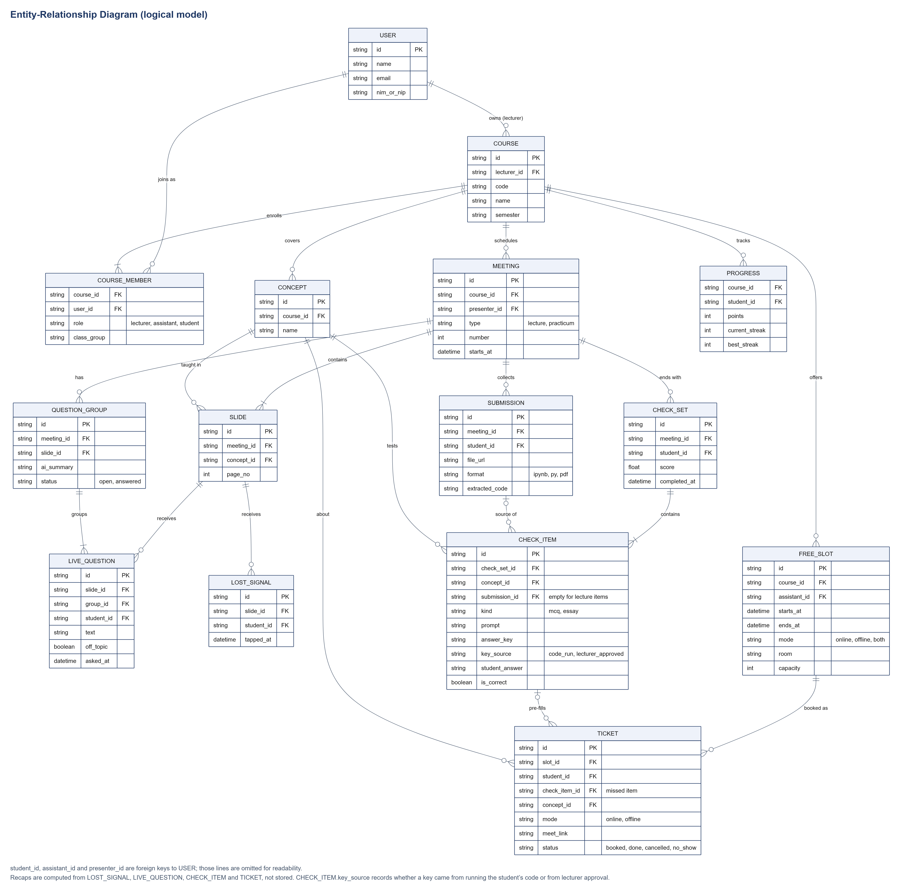

# SAPA: From Lecture Questions to Own-Code Quizzes and Practicum Help

Semifinal Proposal, STACK 2026

Team: wo men bu yi yang

Case 1: Smarter Campus and Learning

Muhammad Ridwan (team leader), Nur Fattah Hamdani, Annisa Sofia Albana, Naufal Fahreza

Telkom University Surabaya

<!-- pagebreak -->

## 1. Project and Team Identity

SAPA is a web application for one university course, built by team wo men bu yi yang from Telkom University Surabaya for Case 1: Smarter Campus and Learning.

| Member | Role in the team | Main build area [TEAM: confirm] |
| --- | --- | --- |
| Muhammad Ridwan | Team leader, practicum assistant | Product scope, practicum quiz content, pitch |
| Nur Fattah Hamdani | Practicum assistant | Notebook runner and code questions (Pyodide, qlcpy) |
| Annisa Sofia Albana | Member | Student and lecturer screens (React) |
| Naufal Fahreza | Member | Firebase data, Gemini functions, deployment |

Muhammad Ridwan and Nur Fattah Hamdani are practicum assistants in the course SAPA is designed for. They assist two different classes of the same student cohort.

## 2. Problem and User Analysis

In our data science course, a student can pass a practicum by submitting code they cannot explain, and neither the lecturer nor the assistants find out until the exam.

### 2.1 Problem context

The course has weekly lectures and 13 weekly Python practicum modules. We see three linked problems.

1. **Students cannot explain code they submitted.** A submitted notebook shows that the code exists and runs. It does not show whether the student understands it.
2. **Students who get lost in a lecture stay quiet.** Asking in front of a large class feels risky, so the lecturer does not learn which slide lost the class.
3. **Assistants start each help request from zero.** One assistant helps many students one by one and has to work out what each student is stuck on before helping.

### 2.2 Target users

| User | What they need | What they do today |
| --- | --- | --- |
| Student | Find out what they do not understand before the exam, and ask without being exposed | Copy or adapt working code, ask a friend, or stay quiet |
| Practicum assistant | Know what a student is stuck on before the help session starts | Read the student's code on the spot while others wait |
| Lecturer | See which slides and concepts lost the class | Rely on the few students who speak up and on exam results |

The lecturer owns the course in SAPA. Assistants are first-class users, because two of our members do this work every week.

### 2.3 Supporting evidence

**Published studies.** Large classrooms make some students apprehensive about asking questions [1]. A lab teaching assistant's firsthand account describes working out each student's problem without prior context while other students wait [2]. In an online introductory programming course, about one third of students struggled to explain their own code, and explaining it tracked course success better than submitting a correct program [3].

**Our own course.** Earlier cohorts of this course pasted their code as screenshots into PDF reports, which cannot be run. The current cohort submits the official weekly post-test as a Colab notebook (.ipynb), so each student's code can now be run, and uploading it to SAPA adds no new file to prepare. The assistants check that these notebooks run, but have no time to ask each student to explain their code. [TEAM: confirm this matches how you grade.]

**Survey of our two practicum classes, 23 to 26 November 2026.** [TEAM: n, response rate, and the main results from questions A2, B1, B2, C1, D2 and E2. Only real numbers.]

### 2.4 Existing alternatives

| Alternative | What it does well | What it does not cover |
| --- | --- | --- |
| Slido | Anonymous live questions with upvotes | Does not connect questions to slides a student missed or to a follow-up quiz |
| Kahoot | Engaging quiz for the whole class | Every student gets the same questions, unrelated to their own code |
| nbgrader | Grades notebooks against tests the instructor writes | Checks that code is correct, not that the student can explain it |
| WhatsApp group for asistensi | Students already use it to ask assistants | No booking of free slots, and the assistant sees no context before the session |

## 3. Proposed Solution

SAPA turns what a student misses in a lecture or practicum into a short personal quiz, and turns a missed quiz question into a help session with an assistant who already knows the concept. The lecturer sets it up for one course.

### 3.1 Main user journey

{w=16}

1. **Learn.** During a meeting, students follow the slides on their own device. They can ask about any slide without classmates seeing their name, or tap "I'm lost". Gemini groups similar questions per slide, so the presenter answers the largest groups first.
2. **Check.** After the meeting, each student gets a short quiz of multiple-choice or short-answer questions.
    - Lecture questions: Gemini drafts them from the slides the student marked "I'm lost", and the lecturer approves them before students see them.
    - Practicum questions: the student uploads their notebook, SAPA runs it in the browser, and qlcpy [4] with our templates writes questions about the student's own code. The answer keys come from running that code.
    - Students see the correct answers after the quiz. Results count only toward participation points.
3. **Assist.** A student who missed a concept books a help session (asistensi) in a free slot that an assistant opened that week, online or offline. The ticket already names the missed concept and the question.
4. **Recap.** The lecturer and assistants see each student's missed concepts and the most-lost slides for each meeting.

### 3.2 Scope of version one

| In version one | Left for later |
| --- | --- |
| One course, one practicum class | Several courses and classes |
| The 9 practicum modules whose libraries run in the browser | The 4 modules that need TensorFlow or PySpark |
| Notebook upload (.ipynb) | Reading code from screenshots or PDF reports |
| Multiple-choice and short-answer questions | Automatic grading of free-text explanations |
| Help-session booking with the missed concept | Video calls inside SAPA (online sessions use a meeting link) |

We checked the imports in the lecturer's 13 practicum notebooks. Nine use only pandas, NumPy, scikit-learn, matplotlib or NetworkX, which Pyodide supports, and they load scikit-learn's built-in datasets instead of downloading files. Version one covers these nine. The other four need TensorFlow (one module) or PySpark (three modules).

### 3.3 Distinguishing features

- **Questions about the student's own code.** Each practicum question is generated from the notebook that student submitted, so copying a friend's answers does not help.
- **Answer keys from running the code.** The correct answer is whatever the student's code produces, so no one writes keys for each submission.
- **One thread from confusion to help.** An "I'm lost" tap leads to a quiz question, and a missed quiz question leads to a help ticket with that concept already filled in.

## 4. Technical Design

SAPA is a React web app on Firebase. Student notebooks run inside the student's browser with Pyodide, and only the Gemini calls run on the server.

### 4.1 Technologies

| Layer | Technology | Role in SAPA |
| --- | --- | --- |
| Front end | React | Student, assistant and lecturer views |
| Sign-in | Firebase Authentication | Roles per course: lecturer, assistant, student |
| Database | Cloud Firestore | Live slide, questions, quizzes, slots and tickets, updated in real time |
| Files | Cloud Storage for Firebase | Slides, lecturer datasets and student notebooks |
| Server logic | Cloud Functions for Firebase | Calls Gemini and keeps its key on the server |
| AI | Gemini API | Groups questions and drafts lecture questions |
| Code runner | Pyodide (Python in the browser) | Runs pandas and scikit-learn code with no server cost per student |
| Question generator | qlcpy [4] | Generates questions about a learner's own Python program |

Cloud Storage for Firebase requires the pay-as-you-go Blaze plan. We will set a budget alert and expect one class to stay within the no-cost usage limits.

{w=14}

### 4.2 Data sources

The lecturer uploads slides (PDF) and the dataset for each practicum module. Students upload their own notebooks, which are used only to build their own quiz. The semifinal video and Final Day demo use notebooks the team wrote, so no real student work appears in any demo. The data model has 15 entities, including Course, Meeting, Slide, Question Group, Submission, Check Item, Free Slot and Ticket (Appendix A).

### 4.3 Running real notebooks

| Case | How SAPA handles it |
| --- | --- |
| `!pip install` lines | Removed before the run; Pyodide loads the supported packages itself |
| Reading files from Google Drive | `drive.mount` is removed and Drive paths point to the lecturer's copy of the dataset |
| A cell raises an error | Later cells still run; questions that depend on the failed cell are skipped |
| The notebook cannot run at all | The student gets questions from reading the code only, and the assistant is notified |

[TEAM: result of testing qlcpy inside Pyodide.] If it does not run there, a small Python function on the server does the same job.

### 4.4 Answer keys computed in the browser

A student with technical skill could change keys computed in their own browser. We accept this in version one because quiz results count only toward participation points. If a lecturer wants quiz results to count toward grades, the server can re-run the notebook to produce the keys.

## 5. Development Plan

We will arrive at Final Day with the Learn and Check steps working, and use the build session to connect missed quiz questions to help-session booking and the recap.

### 5.1 Current progress

| Feature | Status on 30 November |
| --- | --- |
| Live slides with anonymous questions | [TEAM] |
| "I'm lost" tap | [TEAM] |
| Question grouping with Gemini | [TEAM] |
| Notebook upload and run with Pyodide | [TEAM] |
| Practicum quiz from qlcpy | [TEAM] |
| Lecture quiz with lecturer approval | [TEAM] |
| Help-session booking | Not started; planned for Final Day |
| Recap for lecturer and assistants | Not started; planned for Final Day |

### 5.2 Milestones

| Dates | Milestone | Done when |
| --- | --- | --- |
| 21 to 29 Nov 2026 | Proposal, survey, semifinal video | Proposal PDF and Instagram video are submitted |
| 30 Nov to 6 Dec 2026 | Learn step end to end | Team members in a test class can ask, tap "I'm lost" and see grouped questions |
| 30 Nov to 6 Dec 2026 | Check step end to end | A sample notebook produces a quiz with keys from its own run |
| 7 to 15 Dec 2026 | Usability test and fixes | Five students outside the team complete the main flow with sample data |
| 16 Dec 2026 | Final Day build session | Booking and recap connected to the quiz results |
| [TEAM: date] | Pilot in one practicum class | Date agreed with the lecturer |

### 5.3 Member contributions

| Member | Done so far | Before Final Day | On Final Day |
| --- | --- | --- | --- |
| Muhammad Ridwan | [TEAM] | Survey, practicum question templates, video | Pitch and demo |
| Nur Fattah Hamdani | [TEAM] | Notebook runner and qlcpy in Pyodide | Missed concept on the help ticket |
| Annisa Sofia Albana | [TEAM] | Student and lecturer screens | Recap screen |
| Naufal Fahreza | [TEAM] | Firestore data, Gemini functions, deployment | Booking flow and free slots |

### 5.4 Planned Final Day tasks

1. **Help-session booking.** Assistants open free slots for the week, and a student books one from a missed quiz question.
2. **Missed concept on the ticket.** The ticket shows the concept and the question the student missed, so the assistant sees it before the session.
3. **Recap.** The lecturer and assistants see missed concepts per student and the most-lost slides per meeting.

We keep a local demo build and sample data in case the venue network fails.

## 6. Validation and Impact

We will judge SAPA by two numbers: how many students can explain their own practicum code, and how long an assistant needs to understand a help request. Both get a baseline before SAPA is used.

### 6.1 Validation plan

| Step | When | Participants | What we measure |
| --- | --- | --- | --- |
| Survey | 23 to 26 Nov 2026 | Students in our two practicum classes, anonymous | How often they submit code they cannot explain, and how often they stay quiet when lost |
| Usability test | 7 to 15 Dec 2026 | Five students outside the team, sample data only | Share who finish the main flow without help, and time per task |
| Baseline | Before the pilot | One practicum class | Assistant asks each student to explain two lines of their code, scored 0 to 2; minutes per help request |
| Pilot | [TEAM: date] | Same class | The same two measures, and whether quiz scores agree with explanation scores |

The explanation score follows Lehtinen et al. [3], who found that explaining one's own code tracks course success better than submitting a correct program. If quiz scores agree with explanation scores, the quiz can warn students early.

### 6.2 Expected benefit

- Students learn which concepts they missed within days of the meeting, before the exam.
- Assistants spend less time per help request because the ticket names the concept.
- The lecturer sees the most-lost slides for each meeting and can revisit them in the next one.

We will not claim a size for these benefits until the pilot gives real numbers.

### 6.3 Risks

| Risk | What we do |
| --- | --- |
| Gemini groups or drafts questions badly | The lecturer approves every lecture question, and each group shows the original questions underneath |
| Students do not upload notebooks | The official post-test is already a notebook, so the lecturer can make the SAPA upload the way it is submitted |
| Too few assistant slots in a busy week | Assistants see demand per concept and can open more slots or explain the concept to the whole class |

Notebooks that do not run and keys changed in the browser are handled in Sections 4.3 and 4.4.

### 6.4 Privacy

- Student notebooks are never sent to Gemini. Gemini receives only lecture slides and the text of anonymous questions.
- Classmates never see who asked a question. [TEAM: decide whether the lecturer can see the name, for example to handle abusive messages.]
- Students join the pilot only after giving consent, and can delete their uploaded notebooks.
- API keys stay in Cloud Functions and are never committed to the repository.

### 6.5 Sustainability

The lecturer owns each course in SAPA, so it keeps working when assistants change each semester. Pyodide runs student code on the student's own device, so running costs stay low as classes grow. Other practicum courses can join after the pilot.

## 7. References and Declaration

### 7.1 Third-party resources

| Resource | Use in SAPA | License or terms |
| --- | --- | --- |
| React (react.dev) | Front end | MIT |
| Firebase (firebase.google.com) | Sign-in, database, file storage, server functions | Google Cloud terms |
| Gemini API (ai.google.dev) | Question grouping and lecture question drafts | Gemini API terms |
| Pyodide (pyodide.org) | Runs student notebooks in the browser | MPL-2.0 |
| qlcpy (pypi.org/project/qlcpy) | Questions about a learner's own code | MIT |

### 7.2 Material AI assistance

| Tool | Role | What the team did |
| --- | --- | --- |
| Claude (Anthropic) | Helped draft and review the text of the abstract and this proposal | Team members checked every claim and edited the final text |
| Gemini (Google) | Part of the product: groups questions and drafts lecture questions | Lecturer approval is required before students see drafted questions |
| [TEAM: tool, if any] | AI coding assistant used to build the prototype | [TEAM] |

<!-- pagebreak -->

### 7.3 References

1. Montgomery, L., Evans, G., Harrison, F., & Damian, D. (2019). Towards a Live Anonymous Question Queue to Address Student Apprehension. arXiv:1901.01061. https://arxiv.org/abs/1901.01061
2. Markel, J. M., & Guo, P. J. (2021). Inside the Mind of a CS Undergraduate TA: A Firsthand Account of Undergraduate Peer Tutoring in Computer Labs. SIGCSE '21. https://doi.org/10.1145/3408877.3432533
3. Lehtinen, T., Lukkarinen, A., & Haaranen, L. (2021). Students Struggle to Explain Their Own Program Code. ITiCSE '21, 206-212. https://arxiv.org/abs/2104.06710
4. Lehtinen, T. qlcpy, MIT License. https://pypi.org/project/qlcpy/
5. nbgrader documentation. https://nbgrader.readthedocs.io

### Appendix A. Entity-relationship diagram

{w=16}

<!-- pagebreak -->

### Appendix B. Signed Declaration of Originality

[TEAM: official template from the committee, signed by all four members.]